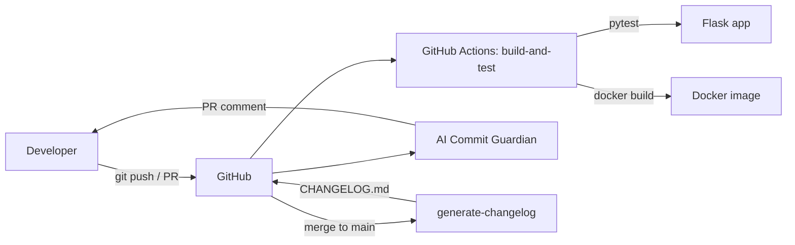

# Project 1 — Architecture

## Components

- **Flask app (`app/main.py`)** — `/`, `/health`, `/api/hello`. Kept small on
  purpose; later projects extend this same service.
- **Dockerfile** — `python:3.12-slim`, non-root user, gunicorn, healthcheck.
- **CI (`ci.yml`)** — three jobs: `build-and-test`, `ai-commit-review`
  (PRs only), `generate-changelog` (merges to `main` only).
- **Commit Guardian (`scripts/commit_guardian.py`)** — rule-based
  Conventional Commits checker scoring 0–100. LLM layer (OpenAI/Gemini/
  Ollama) is an optional upgrade that consumes the same JSON output.
- **Changelog (`scripts/generate_changelog.py`)** — fallback generator;
  CI prefers `git-cliff` when installed.
